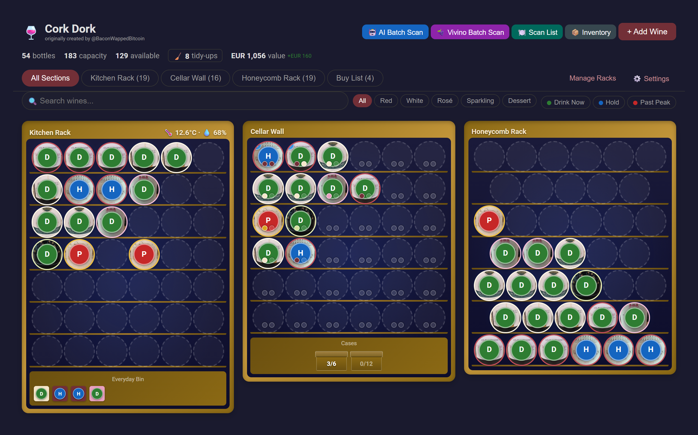
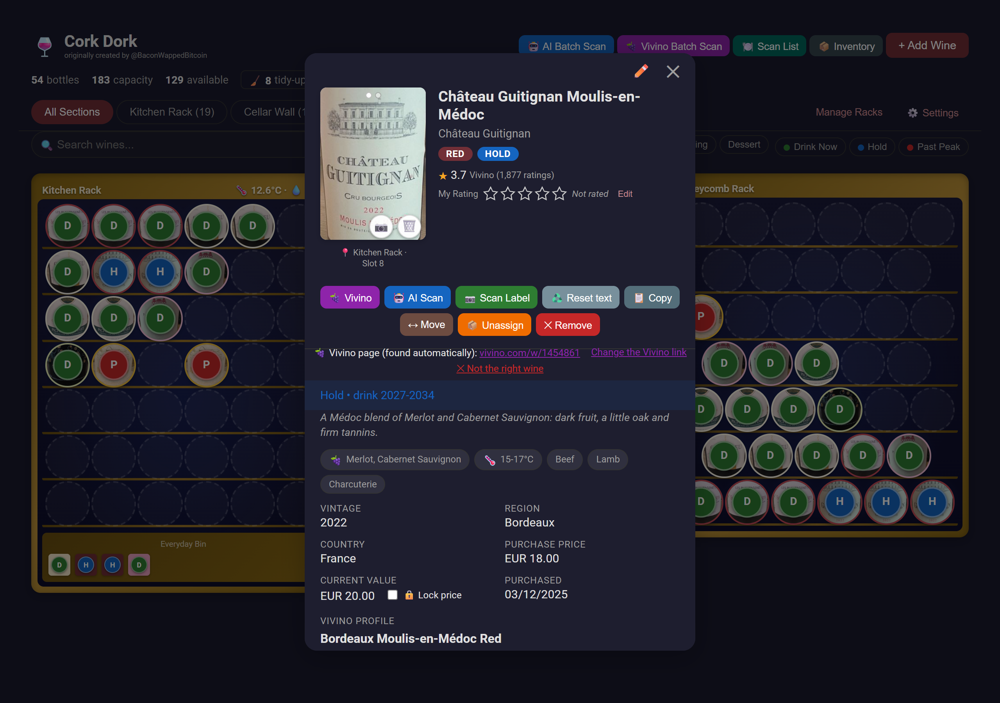
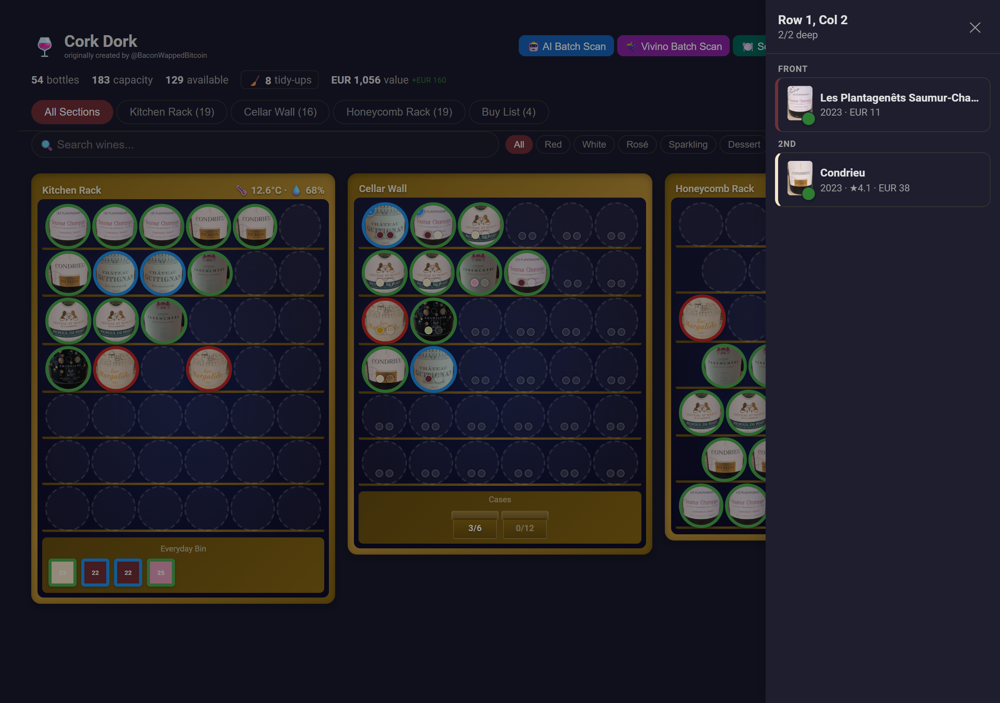
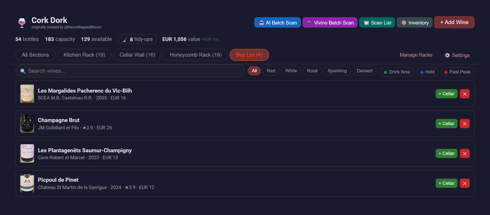

# Cork Dork — Wine Cellar Tracker for Home Assistant

A custom Home Assistant integration for managing your wine collection. Track bottles by location in interactive rack grids, scan labels and wine lists with AI, get Vivino ratings and pricing, drag-and-drop bottles between slots, browse and export your full inventory, and visualize your cellar with a feature-rich Lovelace card.

[](#installation)

*This repository is a fork of [BaconWappedBitcoin/ha-wine-cellar](https://github.com/BaconWappedBitcoin/ha-wine-cellar). Install it from the address given under [Installation](#installation) to get the features described here.*





## Features

### Visual Cellar Management
- **Interactive Cabinet Grid** — Color-coded bottles by type (red, white, rosé, sparkling, dessert, whisky, cider) with thumbnail images, scalable disposition badges (Drink/Hold/Past Peak), and Vivino ratings
- **Deep Rack Support** — Racks can be 1-6 bottles deep; click any deep cell to open the depth side panel showing every bottle stacked front-to-back
- **Depth Side Panel** — Slide-out panel reveals all bottles in a deep cell, click any wine for its detail or tap an empty slot to add a bottle at that specific depth
- **Visual Rack Editor** — Create and edit racks with a live preview and stepper controls for rows, columns and depth. Racks can be any size up to 20×20.
- **Drag & Drop** — Rearrange bottles by dragging on desktop; long-press to move on mobile
- **Move & Swap** — Move button in wine detail or long-press on mobile; bottles swap automatically if the target cell is occupied
- **Copy & Paste** — Duplicate wines across your cellar for multi-bottle purchases
- **Search & Filter** — Filter by wine type or search by name, winery, region, or grape variety
- **Drinking Status** — *Drink now / Hold / Past peak* chips under the search bar filter the main view; on the racks the status can be shown as a letter, a coloured ring, or hidden
- **Tidy-up Suggestions** — The card points out arrangement issues and proposes moves, applied only when you tick them
- **Interface Languages** — The card is translated into English and French and follows your Home Assistant language
- **Statistics Dashboard** — Total bottles, capacity, available slots, total cellar value, and gain/loss at a glance
- **Responsive Design** — Optimized layouts for phone, tablet, and desktop with full dark mode support



### Whisky and Cider

- **Whisky Type** — Off by default, enabled with its checkbox in the Vivino/AI settings. Bottles can then be typed as *Whisky* alongside the five wine types, with their own colour, filter chip and inventory count. A whisky reuses the wine fields: the *Winery* field becomes *Distillery*, *Grape Variety* becomes *Cask* (maturation info), and *Vintage* is the distillation year if the bottle has one.
- **AI, not Vivino** — Vivino has no whisky data, so Vivino lookups and batch refreshes skip whisky bottles. Label recognition and the AI analysis handle whisky labels with their own rules: always *Drink Now* (whisky does not age in the bottle), no drink window, no wine-critic scores, but a tasting description and a price estimate as usual.
- **Cider Type** — Off by default, enabled with its own checkbox in the Vivino/AI settings. A cider reuses the wine fields: *Winery* becomes *Cider house*, *Grape Variety* becomes *Apples*, *Vintage* is the harvest year. Unlike whisky, Vivino does list ciders, so lookups, ratings and refreshes work as for wine; the AI analysis uses its own cider rules (mostly *Drink Now*, chilled serving range, no wine-critic scores).

### Storage Zone Types
- **Bulk Bins** — Open storage for loosely grouped bottles (e.g., daily drinkers, pending sort). Shows individual wine squares with configurable capacity.
- **Wine Boxes** — Multi-box rows with configurable box sizes (e.g., [6, 12, 3]). CSS-drawn box shapes with wine count displayed inside each box (e.g., "2/6") and pack size labels.
- **Zone Side Panel** — Click any storage zone container to open a slide-out panel (same UX as the depth panel) showing all wines in that zone with add/remove capability.
- **Shelves and Staggered Shelves** — Shelf zones with front and back lanes, and staggered ("quinconce") stacks where each row nests into the one below
- **Rack Styles** — A rack is a classic grid, a staggered shelf, a front/back shelf, a bulk bin or a wine box, with an optional second zone of another style above or below it
- **Staggered (Honeycomb) Racks** — Each slot row can hold fewer bottles than the rack is wide; shorter rows are drawn offset by half a slot, like a diamond/honeycomb rack where bottles rest in the gaps of the row below. One click on **Staggered rows** alternates full and one-short rows (e.g. 3/2/3/2), or set each row's count with its own stepper.

### Temperature, Humidity and Serving Advice
- **Rack Sensors** — Give each rack a temperature and humidity sensor (or type the readings in by hand); they are shown on the rack's title line
- **Serving Advice** — With a room temperature sensor set in the integration's options, a bottle's sheet says whether it is ready to serve, how long before serving to take it out, or to chill it briefly

### Inventory Browser & Wine History
- **Full Inventory Dialog** — Browse, search, sort, and export your entire cellar collection from the 📦 Inventory button
- **Wine History** — Track removed bottles with reason (Drank, Gifted, Sold, Broken, Spoiled, Other). Switch between Inventory and History tabs to see your consumption log sorted by date.
- **Multi-Field Search** — Search across name, winery, region, country, grape variety, vintage, barcode, notes, and description
- **Sort Options** — Sort by name, winery, vintage, type, rating, your own rating, price, drink-by date, urgency, purchase date, date added, or cabinet location (ascending/descending)
- **Type Filter Chips** — Quick-filter by type (All / Red / White / Rosé / Sparkling / Dessert, plus Whisky and Cider when enabled)
- **Detailed Filters** — Narrow by country, grape, cabinet, food pairing, minimum rating, maximum price, and vintage range. Food pairings are grouped into categories in French and English; other languages list them as written.
- **Presets** — One-tap views for the questions actually worth asking: Drink this year, Past peak, Not rated, Missing data, Added recently
- **Summary Stats** — Total bottles, estimated collection value, and type breakdown with colored indicators
- **Disposition Search** — Search by "Drink", "Hold", or "Past Peak" to filter by disposition; also searches drink window field
- **CSV Export** — Download your filtered/sorted inventory as a date-stamped CSV file with 26 data columns
- **Server Backup** — Save timestamped backups to the HA server (config/wine_cellar_backups/) with one click
- **Server Restore** — Browse and restore from any previous server backup with a date/size picker
- **Download/Upload** — Download the full cellar as JSON or upload a JSON backup to restore
- **CSV Import** — Import wines from a CSV file
- **Click to Detail** — Tap any wine in the inventory to open the full detail dialog with edit, move, and action capabilities

### Unassigned Wines
- **Unassigned Tab** — When wines exist that are not assigned to any rack (e.g., after rack deletion), an orange "Unassigned" tab appears automatically
- **Always Visible** — Unassigned wines also appear at the bottom of the "All Sections" view so they are never hidden
- **Easy Reassignment** — Tap any unassigned wine to open its detail, then use Move to place it in a rack

### Buy List
- **Wine Wishlist** — Save wines you want to purchase with full detail tracking (ratings, pricing, tasting notes)
- **Quick Add** — Add wines to the buy list from the wine list scanner or the Add Wine dialog
- **Move to Cellar** — One-tap to move a buy list wine into a specific rack position
- **Full Detail View** — Tap any buy list item to see its complete detail with Vivino refresh, AI scan, and tasting notes



### AI-Powered Wine Intelligence
- **Your Provider** — Google Gemini, or any OpenAI-compatible service
- **Your Currency and Language** — AI and Vivino texts and prices follow Home Assistant's own currency and language by default; any ISO 4217 currency and some 60 languages can be picked in the settings
- **Price Lock** — Lock a bottle's current value so AI and Vivino scans never change it
- **One-Scan Label Recognition** — Snap a photo of a wine label and Google Gemini identifies the wine and provides a full sommelier assessment in one call: name, winery, vintage, type, region, grape variety, disposition, drink window, tasting description, estimated price, and critic rating estimates (Wine Spectator, Robert Parker, James Dunnuck, Antonio Galloni)
- **AI Batch Scan** — One-click full AI analysis on your entire cellar: disposition, drink windows, descriptions, pricing, and ratings for every bottle
- **Wine List / Receipt Scanner** — Photograph a restaurant wine list or store receipt and get every wine extracted with AI-powered analysis in a single call: critic scores, disposition, drink window, description, retail price estimates, and markup percentages. Highlights best-value picks and lets you add any wine to your cellar or buy list with one tap. Shows "IN CELLAR" badge and your personal score when a scanned wine matches one already in your collection. Optionally enrich with Vivino ratings and images. Supports long lists (up to 3 minute timeout).
- **Gemini Price Fallback** — When Vivino has no pricing data, Gemini AI provides estimated retail prices as a fallback for single wine refresh and batch scans
- **Auto-Enrich on Add** — When you add a wine, Vivino data (rating, price, description, food pairings) is automatically fetched in the background

### Dashboard Tiles
- **Section Card** — Put a single rack on any dashboard as its own tile with `custom:wine-cellar-section-card` (or pick **Cork Dork — Section** in the card picker and choose the section). It shows that rack's grid, sensor reading and bottle count; tap a bottle for its details, tap a free slot to add a bottle there. It stays in sync with the full card; moving and copying bottles stay in the full card.

  ```yaml
  type: custom:wine-cellar-section-card
  section: Kitchen        # rack name or id
  title: Wine fridge      # optional
  show_header: true       # optional, bottle count line
  ```

### Vivino Integration
- **Cellar Connection** — Connect your Vivino cellar by signing in with your Vivino email and password, or by pasting your cellar URL and session cookie (see **[docs/vivino-import.md](docs/vivino-import.md)**). One tap on the card's button then brings in every bottle you own (with ratings, images, region, grape data, and your personal star ratings/notes) as unassigned wines. Bottle counts are respected and already-imported bottles are never duplicated.
- **Vivino Mode: Import or Synchronize** — Chosen in the integration's options. **Import** (the default) is a one-way mirror: Vivino is the source of truth and Cork Dork follows it; nothing is ever written to your Vivino account. **Synchronize** is a two-way reconcile: bottles you add or drink in Cork Dork are pushed back to your Vivino cellar as cellar events (visible and undoable in Vivino's history), guarded so a bad fetch can't wipe Cork Dork and corrupt local data can't wipe Vivino. The card's button reflects the mode — ⬇️ Vivino Import or 🔄 Vivino Sync.
- **You Pick the Bottle** — When Vivino loses a bottle and the choice of which physical bottle to remove is obvious (the wine is gone entirely, or unplaced bottles cover it), Cork Dork handles it and the sync toast reports the count. When a placed bottle would have to go and there are several to choose from, nothing is deleted: the card shows a panel, selecting the wine rings every candidate bottle in your racks in orange, and you click the bottle that is actually gone and confirm. Removed bottles are archived to history either way.
- **Conflicts Are Yours to Settle** — If both sides changed the same wine between syncs (say a bottle drunk on Vivino while one was added in Cork Dork), the sync changes nothing and the card shows the conflict. Selecting it rings all of your local bottles for review; after correcting anything that's off, one confirmed click declares Cork Dork's count the truth and updates Vivino to match.
- **Auto Sync** — Optionally sync the cellar automatically twice a day. When the sign-in or session cookie expires, a notification asks you to renew it.
- **Sync Service & Sensor** — `wine_cellar.sync_vivino` service for automations plus a `Cork Dork Vivino Cellar` sensor reporting the last sync
- **Vivino Batch Scan** — Refresh all wines from Vivino in one click: ratings, review counts, market pricing, descriptions, food pairings, alcohol content, and grape variety. Falls back to Gemini AI pricing when Vivino has no price.
- **Individual Vivino Refresh** — Update any single wine's Vivino data from the detail dialog
- **Vivino Profile** — For wines linked to Vivino, the wine sheet also shows what the Vivino app shows on the wine's page: the **wine style**, the **taste profile** (light↔bold, smooth↔tannic, dry↔sweet, soft↔acidic, gentle↔fizzy), the **main flavours**, and any **awards and critic scores**, in your metadata language. Fetched on refresh (single or batch), when a bottle is added, and in the background after a Vivino account sync.
- **Choose the Vivino Page** — Paste a Vivino page address to link a bottle to it, mark an automatic match as *Not the right wine*, or remove the link
- **Your Photo Stays Yours** — Refuse Vivino's photo for one wine, or always keep your own
- **Wine Search** — Search Vivino by name to find and add wines without a barcode
- **Wine List Vivino Enrichment** — After scanning a wine list, optionally click "Get Vivino Scores" to add Vivino ratings and images to your results

### Scanning & Input
- **Camera Barcode Scanning** — Point your phone or tablet camera at a barcode to auto-lookup details from Vivino and Open Food Facts
- **Label Scanning** — Take a photo of a label, or pick one from your photo library. It is read by the AI, or recognised by Vivino first when you are signed in with your Vivino email.
- **Manual Entry** — Add wines by hand with a comprehensive form

### Ratings & Notes
- **Interactive Half-Star Rating** — Rate wines from 0.5 to 5.0 stars
- **Structured Tasting Notes** — Record aroma, taste, finish, and overall impression
- **AI Critic Estimates** — Gemini provides estimated scores from Wine Spectator, Robert Parker, James Dunnuck, and Antonio Galloni
- **Vivino Community Ratings** — Real ratings and review counts from Vivino's user base

### Home Assistant Integration
- **HA Sensors** — Entities for total bottles, capacity percentage, and per-cabinet counts for use in automations and dashboards
- **Services** — Automate adding, removing, and moving wines via HA services

## Installation

Since Home Assistant **2026.11**, HACS is built into Home Assistant under the name **Marketplace**. Follow the steps for your version. Cork Dork is not in the default catalog, so it is added as a custom repository: `https://github.com/JYves72/ha-wine-cellar`

### Home Assistant 2026.11 or newer (Marketplace)

Adding a custom repository requires a GitHub account; the Marketplace asks you to connect it the first time.

1. Go to **Settings > Marketplace**
2. In the upper-right corner, select **Add from link**
3. Under **GitHub link**, enter `https://github.com/JYves72/ha-wine-cellar`, then select **Add** (if asked for a **Type**, choose **Integration**)
4. Open **Cork Dork** in the list, select **Install**, then **Install** again to confirm
5. Restart Home Assistant

If you already had Cork Dork in HACS before updating Home Assistant, it is carried over to the Marketplace and keeps receiving updates: there is nothing to reinstall.

### Home Assistant 2026.10 or older (HACS)

1. Open **HACS**
2. Select the three dots in the top right, then **Custom repositories**
3. Add `https://github.com/JYves72/ha-wine-cellar` with category **Integration**
4. Search for **Cork Dork** and select **Download**
5. Restart Home Assistant

### Manual

1. Copy the `custom_components/wine_cellar` folder into your Home Assistant `custom_components` directory
2. Restart Home Assistant

After any update, restart Home Assistant, then hard-refresh the browser tab (Ctrl+Shift+R, or Cmd+Shift+R) or fully close and reopen the mobile app.

## Setup

1. Go to **Settings > Devices & Services > Add Integration**
2. Search for **Cork Dork** and follow the setup flow
3. Add the Lovelace card to your dashboard:

```yaml
type: custom:wine-cellar-card
title: Cork Dork
```

### AI Features (Optional)

To enable label recognition, AI analysis, wine list scanning, and batch AI scanning:

1. Get a free API key from [Google AI Studio](https://aistudio.google.com/apikey), or have the address and key of an OpenAI-compatible service
2. Go to **Settings > Devices & Services > Cork Dork > Configure**
3. Pick the **AI provider** and enter its key (and, for an OpenAI-compatible service, its base URL and model name)
4. Features unlocked:
   - **Recognize Label** button in the Add Wine dialog (camera to full analysis in one scan)
   - **AI** button on individual wines (full analysis with disposition, ratings, pricing)
   - **AI Batch Scan** button in the card header (analyze all wines at once)
   - **Scan List** button to photograph wine lists and receipts for instant analysis
   - **Gemini price fallback** when Vivino has no pricing data

### Connecting Your Vivino Cellar

There are two ways to connect your Vivino account:

- **Sign in with email and password (recommended).** Cork Dork signs in the way
  the Vivino mobile app does (OAuth against `api.vivino.com`) and reads the
  cellar from the app's own endpoints. The session renews itself, so there is
  nothing to paste and nothing to refresh by hand. The password is used once to
  sign in and is never stored. Signed in this way, **label photos are
  recognised by Vivino itself** (the same recognition as the app's camera),
  which names the exact Vivino wine and vintage; AI label reading becomes
  the fallback for labels Vivino does not know, and is optional.

  This sign-in is **unofficial**: Vivino may block it at any time. Label photos
  are sent to Vivino and appear in your Vivino scan history, and the wishlist is
  not imported this way.
- **Session cookie.** Paste your cellar URL and a session cookie copied from
  your browser; Cork Dork replays it against the website's Inertia.js cellar
  endpoint on `www.vivino.com`. When the cookie expires, a notification prompts
  you to paste a fresh one.

- **[docs/vivino-import.md](docs/vivino-import.md)** has full instructions:
  - **Integration sync:** sign in (or paste your cellar URL and session cookie)
    in **Cork Dork → Configure**, pick the Vivino mode there (Import, the default,
    never writes to your Vivino account), then use the card's button — **⬇️ Vivino
    Import** or **🔄 Vivino Sync**, whichever the mode gives you — or enable
    twice-daily auto-sync.
  - **One-time CSV export:** run a browser-console snippet and load the file via
    **📦 Inventory → Import CSV**.
- After importing, **🍇 Vivino Batch Scan** enriches wines with ratings, pricing,
  descriptions, and images from Vivino's public data.

## Default Cabinet Layout

The integration ships with 3 cabinet sections, each with 10 rows and 9 columns (90 slots per section, 270 total). The bottom row of each section defaults to a bulk bin storage zone. Rack dimensions (up to 20×20), names, depth (1-6 bottles deep), per-row storage types (Slots, Bulk Bin, Wine Box) and per-row slot counts for staggered racks can all be customized through the **Manage Racks** button in the tab bar.

## Data Sources

| Source | Data Provided |
|---|---|
| **Vivino** | Wine name, winery, region, country, type, vintage, rating, ratings count, image, grape variety, description, food pairings, alcohol %, market price, drinking window, wine style, taste profile, flavours, awards, critic scores |
| **Open Food Facts** | Wine name, brand, origin, country, image |
| **UPC Item DB** | Wine name, brand (barcode lookup) |
| **AI provider** (Google Gemini or OpenAI-compatible) | Label recognition, wine list extraction, full wine analysis (disposition, drink window, description, estimated retail price, critic rating estimates), price fallback |

## Services

| Service | Description |
|---|---|
| `wine_cellar.add_wine` | Add a wine bottle to your collection |
| `wine_cellar.remove_wine` | Remove a wine bottle (optional reason: drank, gifted, sold, broken, spoiled, other) |
| `wine_cellar.move_wine` | Move a wine to a different cabinet/position |
| `wine_cellar.scan_barcode` | Look up a barcode and fire a result event |
| `wine_cellar.sync_vivino` | Import your Vivino cellar and wishlist (target: all, cellar, or wishlist). The wishlist needs the session cookie connection. |

## Sensors

| Entity | Description |
|---|---|
| `sensor.cork_dork_total_bottles` | Total number of bottles in your cellar |
| `sensor.cork_dork_capacity` | Percentage of cellar capacity used |
| `sensor.cork_dork_<rack name>` | Bottle count per rack |
| `sensor.cork_dork_vivino_cellar` | Bottles in your Vivino cellar at last sync (with sync details as attributes) |

These are the identifiers of a new install; an older install may have kept earlier ones.

## License

MIT
